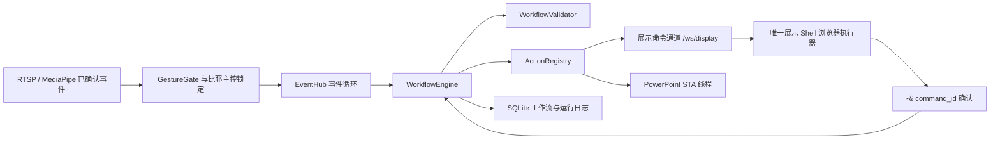

# 展厅工作流

## 结构



识别层仍只发布已经稳定确认的手势。普通手势稳定确认后会同时发布 workflow_triggered 事件，不再要求必须先命中旧版播放器动作映射；工作流触发优先，未被工作流接管的事件仍可按旧映射兼容执行。`WorkflowEngine` 在 FastAPI 事件循环中执行，不占用 RTSP 解码线程或 MediaPipe 推理线程。每次触发最多运行一个展示工作流；主控进入 `suspect` 时保留当前工作流，并在下一节点前等待原主控手部轨迹重新获得唯一匹配；身份匹配恢复后继续，进入 `reacquiring`、解除主控、流断开或展示页断开时取消剩余步骤。

只有外层展示控制中心 `/` 建立 `/ws/display` 执行通道；该页面始终保留在顶层，内部通过同源 iframe 加载已登记的展示主页。切换 `promo`、`factory`、`product` 时只替换 iframe 内容，外层 WebSocket 不会断开。外层同时持有 `/ws/events` 并将事件转发给当前页面。第二个展示控制中心客户端会以 WebSocket 1013 拒绝。展示控制中心断开后暂停新工作流，重新打开主页即可恢复。

## 手势指针与网页拖拽

工作流编辑器提供独立的“手势拖拽”开关。开启后，只有已锁定主控人员的手部可以控制指针；进入 `suspect` 时还必须通过原主控手部轨迹的唯一匹配。伸出食指移动光标，拇指与食指捏合按下，保持捏合移动可拖动工作流节点，松开完成放置。编辑器还提供横向镜像开关，用于适配不同摄像头安装方向。

主控生命周期包含 `unlocked`、`locked`、`suspect` 和 `reacquiring`。人体轨迹首次漏检时进入 `suspect`，默认保留 650 ms；系统仅对最近在 LOCKED 状态中观察到的主控手部轨迹做短时连续性匹配。唯一匹配成功时允许该手继续控制，匹配缺失或歧义时暂停手势和指针。工作流在节点边界等待身份确认，确认后继续；进入 `reacquiring` 后释放指针并取消工作流，总恢复窗口默认 3500 ms。同一 `track_id` 在窗口内重新出现后恢复原 `controller_id` 对应的主控会话。超过窗口才自动解锁。新人员在恢复期间不能通过比耶手势抢占控制权。

指针数据由 MediaPipe 21 点关键点计算，后端使用食指指尖坐标、掌宽归一化捏合距离、双阈值迟滞和 One Euro 自适应低通滤波。默认 `min_cutoff=1.0`、`beta=0.025`、`derivative_cutoff=1.0`；捏合按下/释放阈值为 0.36/0.50，分别需要连续 2 帧确认；食指伸展夹角门槛为 140°，指针事件最高推送频率为 45 Hz。短暂漏检会保留最后一个光标位置最多 350 ms；若漏检发生在拖拽期间，会立即释放按压状态，避免节点被一直拖住。指针参数保存在 SQLite，可通过 `GET /api/pointer/settings` 读取、通过 `PUT /api/pointer/settings` 部分更新；支持的字段为 `min_cutoff`、`beta`、`derivative_cutoff`、`press_threshold`、`release_threshold`、`press_stable_frames`、`release_stable_frames`、`max_update_hz` 和 `dropout_grace_ms`。指针模式会对主控手增加一次更宽但仍经过多人歧义检查的手腕关联尝试。指针事件经 `/ws/events` 单独发布，不进入工作流动作执行通道。启用指针模式时暂停普通手势工作流触发与兼容播放器动作，避免移动和捏合误触发；比耶主控锁定仍保留。主控解除或视频流断开时立即释放拖拽状态.

前端提供四角校准：开启手势拖拽后，点击“**四角校准**”，依次将光标对准画布左上、右上、右下、左下的目标圆点，并在每个位置捏合一次确认。浏览器使用四组摄像头坐标与画布目标坐标计算透视单应矩阵，将摄像头归一化坐标映射到画布视口；校准矩阵和镜像方向偏好保存在当前浏览器的 localStorage。切换镜像方向会使原校准失效，需要重新采集。未校准时仍可使用线性坐标映射。

画布坐标转换统一考虑视口位置、滚动偏移和缩放比例。拖动节点时记录手指在节点内部的实际抓取偏移，不再把节点中心强制吸附到光标；节点位置只在画布范围内更新。指针事件通过 `requestAnimationFrame` 合并处理，但按下、释放、active 和身份/轨迹切换等状态边沿会按顺序保留，只合并纯坐标移动样本，避免捏合和松开恰好落在同一帧时丢失操作。主控解除、视频流断开或页面离开时会清空待处理队列，防止过期事件重新触发拖拽。拖动时只更新当前节点的 left/top 及与该节点相连的 SVG 连线/标签，不重建整张画布或全部连线。鼠标拖动节点也沿用相同的世界坐标和抓取偏移计算。

工作流工具栏提供“**指针诊断**”面板，用于真实摄像头验收。面板显示最近 5 秒事件频率、事件间隔 P95、requestAnimationFrame 等待 P95、单次指针处理最大耗时、节点位置/连线更新最大耗时、被合并的移动样本数，以及捏合、拖拽释放和异常中断计数。可导出 JSON，包含当前指针设置、画布缩放/尺寸、最近 120 条归一化坐标事件和性能统计；数据只在浏览器本地生成，不上传服务器，也不包含 controller_id 或 hand_track_id。

当前网页拖拽实现范围是本项目 `/workflows` 画布中的节点；不会模拟 Windows 系统鼠标，也不承诺驱动任意第三方网页、浏览器原生文件拖放或跨域 iframe。

## Display Shell 与展示主页注册

首页 `/` 是常驻 Display Shell，不再直接承载某一个具体展示页面。展示页面登记数据保存在 SQLite 的 `display_pages` 表；首次初始化时从 `app/display_pages.py` 一次性播种内置页面。当前默认页为 `promo`，本地模板页为 `factory` 与 `product`。康晋电气官网以 `company_website` 登记，并预置关于我们、产品中心、新闻中心、加入我们、联系我们等同域名子页面；产品、公司介绍和新闻栏目也有对应的二级页面。登记信息持久化在 SQLite，页面 ID 与完整层级名称动态进入 `web.navigate_page` 动作 Schema。升级到网页登记种子版本 2 时会补齐缺失的预置页面，但不会覆盖已有页面的自定义标题、网址或父级关系。用户仍可在 `/display-pages` 登记任意公开 HTTPS 网站及其子页面，不需要提供源代码；子页面必须与父页面使用相同主机名。

工作流动作 `web.navigate_page` 只接受登记表中的 `page_id`，不接受工作流传入的 URL。对本地页面，Shell 仍校验 `/static/pages/` 路径，并等待页面发送与当前 `shell_generation` 匹配的 `display:ready` 消息。对外部页面，Shell 根据服务端返回的已登记页面目录动态建立允许列表，并在浏览器端再次校验 HTTPS、公开域名和父子页面同主机名关系；加载时设置 `no-referrer` 并等待 iframe 的导航 `load` 事件。由于浏览器同源策略，load 事件不能证明第三方页面内容已成功渲染，现场仍须目视验收。外部页面是只读展示：Shell 不向它转发手势/事件，不向它发送内部动作，切换回本地页后原有通信恢复。外部站点若通过 `X-Frame-Options` 或 CSP `frame-ancestors` 禁止嵌入，浏览器会阻止显示；本项目不会绕过该安全策略，需要网站管理员授权嵌入来源，或改用新窗口展示（新窗口不属于当前 Shell 内嵌方案）。

新增展示主页的步骤：

1. 本地页面仍需在 `web/pages/` 放置静态 HTML，并在首次部署时登记本地路径。
2. 外部网页在 `/display-pages` 中填写页面 ID、名称、HTTPS URL 和可选父页面；不需要下载或上传网页源代码。
3. 子页面只能挂在已启用的外部网页下，并必须使用父页面相同的主机名。页面管理支持编辑、启用/停用、删除和设置默认页面；默认页、仍有子页面或仍被工作流引用的页面不能删除。
4. 工作流动作 `web.navigate_page` 选择任意已启用登记页面；`web.navigate_parent` 返回当前子页面的父页面，顶层网页则返回默认展示主页。

### 康晋电气官网预置页面

官网页面树以 `company_website` 为根节点。预置栏目包括：

- 关于我们：公司简介、企业文化、发展历程、营销网络。
- 产品中心：综合能源及智能运维解决方案、储能、充电桩、环网柜/户外真空开关、变压器、高低压成套、配电自动化、元件系列。
- 新闻中心：公司新闻、行业资讯、康晋文苑。
- 加入我们：校园招聘、社会招聘。
- 联系我们。

在工作流中添加 `web.navigate_page` 后，页面选择器会显示完整层级名称，例如“康晋电气官方网站 / 产品中心 / 储能系列产品”。切换到官网子页面后，可用 `web.navigate_parent` 返回父级栏目。外部页面仍只支持整页导航，不支持 DOM 点击、滚动或改写第三方网页内容。
5. Shell 只加载服务端登记的 `page_id`，不接受工作流传入的任意 URL。外部页面不注入脚本、不转发手势事件，也不支持跨域 DOM 点击。

地址检测只做 URL 结构校验，不会从服务器请求第三方网站；浏览器是否允许 iframe 嵌入仍须现场目视验收。Shell 独占 `/ws/display` 与 `/ws/events`，iframe 页面不能另建展示执行连接。

## JSON 协议

工作流使用 `schema_version: 1`。最小可运行定义：

```json
{
  "schema_version": 1,
  "id": "welcome-flow",
  "name": "欢迎展示",
  "description": "欢迎手势播放宣传片",
  "enabled": false,
  "trigger": {"type": "gesture_trigger", "gesture": "Open_Palm"},
  "nodes": [
    {"id": "play", "type": "action", "action": "video.play", "params": {}, "timeout_ms": 3000, "on_error": "stop", "retries": 0},
    {"id": "end", "type": "end", "params": {}}
  ],
  "edges": [{"source": "play", "target": "end"}],
  "version": 1,
  "created_at": "2026-11-11T00:00:00+00:00",
  "updated_at": "2026-11-11T00:00:00+00:00"
}
```

定义必须有唯一起点、唯一 ID、可达节点和结束节点。循环不允许。条件节点必须各有一条 `true`、`false` 边；动作错误分支 `on_error: "branch"` 必须各有一条普通边和 `when: "error"` 边。自动重试最多 2 次，并且只对注册表标记为幂等的动作开放。`web.navigate_route` 必须直接连接到结束节点，因为离开外层展示控制中心后执行客户端会断开。`web.navigate_page` 只切换登记的展示 iframe，不会断开外层执行通道，可继续连接后续动作节点。

工作流编辑器左侧的“手势工作流映射”面板汇总已保存工作流的启动手势、启用状态和目标页面。要用多个手势控制同一个登记页面，分别创建多个工作流并为它们分配不同的启动手势，再在动作节点中选择同一个页面或同一组页面动作。每个普通手势只能绑定一个已启用的工作流；重复触发器会在启用时被拒绝。设置页不再维护独立的全局手势映射表；旧版映射数据保留用于兼容回退。

AI 文档生成器的 API Key 可直接在 /workflows 的 AI 生成窗口填写。密钥由本机服务端写入项目根目录 .env（该文件已被 .gitignore 忽略），接口只返回是否已配置，不回传密钥。

触发器：

| type | 参数 |
| --- | --- |
| `gesture_trigger` | `gesture` 为内置手势之一 |
| `gesture_sequence_trigger` | `gestures` 为 2～5 个内置手势；`sequence_window_ms` 为 1000～30000，默认 5000 |
| `controller_locked` | 无额外参数；最近 5 帧中至少 2 帧检测到同一主控人员的比耶手势后触发 |

节点：

| type | 参数 / 行为 |
| --- | --- |
| `action` | `action`、`params`、`timeout_ms` 100～60000、`on_error` (`stop` / `continue` / `branch`)、`retries` 0～2 |
| `condition` | `params.field` 只可为 gesture、confidence、handedness、target_id、action；比较方式 eq/ne/gt/gte/lt/lte/in |
| `delay` | `params.delay_ms` 0～30000 |
| `wait_event` | 等待 controller_locked、controller_lost（suspect、reacquiring 或 unlocked）或指定内置 gesture；支持 `timeout_ms` |
| `end` | 空 params，无后继 |

画布位置保存在节点的可选 `position: {"x": number, "y": number}`，范围 0～5000。编辑器参数控件直接读取 `GET /api/actions` 的注册 Schema，不执行或保存用户代码。

## 动作注册表

网页动作：

| action | 参数 |
| --- | --- |
| `web.navigate_route` | `route`: home / settings / workflows；离开展示 Shell 的管理路由，只能作为最后一个动作 |
| `web.navigate_page` | `page_id`: 当前已启用的动态登记页面 ID；切换已登记展示主页，执行通道保持连接；外部网页仅整页展示 |
| `web.navigate_parent` | 无参数；返回当前网页的父页面，顶层网页返回默认展示主页 |
| `web.set_scene` | `scene`: welcome / company_intro / product_intro / factory_intro / presentation_mode |
| `web.show_panel`, `web.hide_panel` | `panel`: welcome / company / product / factory / presentation |
| `web.set_text` | `field`: headline / subhead / notice；`text` 最长 160 字符，使用 textContent 写入 |
| `web.return_home` | 无 |

视频动作：`video.load` 接收 `media_id`；`video.play`、`video.pause`、`video.mute`、`video.unmute` 无参数；`video.seek` 接收 0～86400000 的 `position_ms`；`video.set_volume` 接收 0～1 的 volume；`video.set_loop` 接收 boolean `enabled`。`video.load` 会先验证素材登记和文件存在，再向浏览器发送命令。默认素材 ID `company-promo` 兼容原宣传片。

PPT 动作：`ppt.open_deck`、`ppt.start_slideshow`、`ppt.next_slide`、`ppt.previous_slide`、`ppt.goto_slide`、`ppt.end_slideshow`。每个动作都要求登记的 `deck_id`；跳转另需 `slide_number` 1～10000。所有 COM 调用在专用 STA 线程中执行。

外层展示 Shell 收到 `{type:"command", run_id, command_id, action, params, timeout_ms}` 后，先处理页面调度动作，再将普通展示动作通过严格校验来源窗口和同源 origin 的 `postMessage` 转发给当前 iframe 页面，并等待页面返回结果。Shell 最终返回 `{type:"ack", run_id, command_id, success, result, error}`。切换页面时，Shell 等待新页面发送匹配 page_id 与 generation 的 ready 消息后才确认成功；页面路径来自服务端白名单，不接受工作流提供的任意 URL。服务端只接收当前单一 Shell 客户端、且 run/command ID 均匹配的确认。Shell 在页面切换期间持续持有 `/ws/display`，并对已完成 command ID 去重。连续发起页面切换时采用最新 generation，旧页面加载等待和旧页面动作会被明确拒绝，不会悬挂到超时；页面离开/进入浏览器后退缓存（BFCache）时清理等待项，并在恢复时重连两条 WebSocket。页面动作转发失败会立即清理 pending 记录。超时单独记录为 `timeout`，其它错误为 `failed`，取消为 `cancelled`；错误不会静默进入下一个节点。运行记录仅存触发摘要，不保留 21 个手部关键点。

## 编辑与 API

打开 `http://127.0.0.1:8000/display-pages` 管理展示网页：可以新增 HTTPS 网址、选择父页面、编辑、启用/停用、删除和设置默认展示页面。页面目录会明确显示“工作流可调用/不可调用”状态；外部网页同时显示“嵌入兼容性待现场验证”，避免将 URL 格式校验误认为 iframe 一定可用。地址检测只校验 URL 格式，不会请求第三方站点。编辑已停用子页面时，会保留其原有的已停用父页面关系；父页面即使只有已停用子页面，也不能修改为不同域名。新增页面 ID 会实时出现在工作流 `web.navigate_page` 参数选项中。

打开 `http://127.0.0.1:8000/workflows`。左侧可拖入或点击节点；选中节点后可编辑动作参数、超时、失败策略和重试。使用“连线”后选择起点和目标；条件/错误分支先设置连线条件。拖动画布节点可改变布局，滚动条平移，缩放和自动排列只改变编辑视图/节点位置。每次保存定义变化会创建一个版本；复制会得到禁用的新工作流。模拟运行写入 dry-run 运行记录，但不会调用任何动作适配器。

| 方法 | 路径 | 用途 |
| --- | --- | --- |
| GET / POST | `/api/workflows` | 列出 / 新建 |
| GET / PUT / DELETE | `/api/workflows/{id}` | 读取 / 更新 / 删除 |
| POST | `/api/workflows/{id}/validate` | 校验已保存定义 |
| POST | `/api/workflows/validate` | 校验编辑草稿 |
| POST | `/api/workflows/{id}/dry-run` | 无副作用模拟 |
| POST | `/api/workflows/{id}/enable`、`disable`、`copy` | 启停 / 复制 |
| GET | `/api/workflows/{id}/versions` | 列出版本 |
| GET | `/api/workflow-runs`、`/api/workflow-runs/{run_id}` | 运行与步骤日志 |
| POST | `/api/workflow-runs/{run_id}/cancel` | 取消活动运行 |
| GET | `/api/actions` | 动作及参数 Schema |
| GET | `/api/display/pages?include_disabled=true` | 已登记展示页面；默认只返回启用页面 |
| POST / PUT / DELETE | `/api/display/pages`、`/api/display/pages/{page_id}` | 新增 / 修改 / 删除外部 HTTPS 页面 |
| POST | `/api/display/pages/validate-url` | 校验 HTTPS URL 格式与公共域名限制，不发起外部网络请求 |
| POST | `/api/display/default` | 设置已启用的默认展示页面 |
| GET | `/api/media-assets`、`/api/presentations` | 白名单资源与可用状态 |
| GET | `/api/workflow-status` | 大屏客户端、主控和运行状态 |
| WebSocket | `/ws/display` | 唯一大屏命令执行与确认 |
| GET / POST | `/api/pointer/mode` | 读取 / 开关手势指针模式 |
| GET / PUT | `/api/pointer/settings` | 读取 / 持久化指针滤波、捏合阈值、稳定帧数和更新频率 |
| WebSocket | `/ws/events` | 推送手势、主控、工作流及低频指针事件 |

保存 API 仍沿用本机来源限制。开启动作触发相互重叠的工作流会返回 409；运行中的其它工作流会被拒绝，不会并行争抢展示屏。

## 媒体与 PPT 配置

在 `app/settings.py` 的 `MEDIA_ASSETS` 添加 ID、标题和 `media/` 目录下的文件名。只能登记单个文件名，不可填目录或任意路径。将文件放入本地 `media/`，重启服务后编辑器会列出素材；文件缺失时资源显示不可用，执行 `video.load` 会停止后续节点。

在同一个文件的 `PRESENTATION_DECKS` 添加受信任的 `deck_id`、标题和本机绝对路径：

```python
PRESENTATION_DECKS = {
    "company-deck": {"title": "公司介绍", "path": r"D:\Showroom\company.pptx"},
}
```

服务启动时只把管理员代码配置的 ID/路径同步到数据库，API/工作流参数不接受文件路径。Windows 原生控制需要本机安装 PowerPoint；`pywin32` 是可选依赖，不加入项目基础依赖：

```powershell
.\.venv\Scripts\python.exe -m pip install pywin32
```

若 PowerPoint 或 pywin32 不存在、PPT 文件缺失或放映命令失败，运行步骤会记录明确失败，并按节点的错误策略停止/分支。

## SQLite 与兼容性

首次打开数据库时以 `CREATE TABLE IF NOT EXISTS` 增加 `workflows`、`workflow_triggers`、`workflow_versions`、`workflow_runs`、`workflow_step_runs`、`media_assets`、`presentation_decks`。原来的 `settings`、`gesture_mappings`、置信度配置、控制会话表和事件表保持不变；没有删除旧记录的迁移。运行记录上限为 500 条，步骤记录上限为 5000 条。版本快照与工作流一起保留。

旧 `/api/mappings` 和没有同手势工作流接管时的主页播放、暂停、音量、静音逻辑仍保留。手势置信度、双手状态、比耶锁定几何、PoseTrack、RTSP 解码/最新帧队列没有重构。

## 验证状态

自动化覆盖五个顺序动作、条件和错误分支、主控与展示连接约束、运行并发拒绝、命令确认与断开、dry-run、数据库版本、缺失视频、路径/动作白名单及 PowerPoint 不可用错误。执行：

```powershell
.\.venv\Scripts\python.exe -m unittest discover -s tests -v
```

真实展厅摄像头、实际 PowerPoint 安装、60 分钟资源稳定性和现场交互验收不属于自动化模拟结果；部署前需在目标展示机完成这些检查。


## 离线工作流编排

工作流的创建、编辑、鼠标拖拽、参数设置、保存、校验和 dry-run 不依赖摄像头。摄像头只用于真实手势触发工作流，以及开启“手势拖拽”指针模式。编辑器会在尝试开启手势拖拽时检查视频流状态；未启动摄像头时给出提示，但不影响鼠标和键盘编辑。

## AI 文档生成器

编辑器中的“AI 生成”入口把文档理解与工作流运行时分开：文档解析器提取 PDF、DOCX、TXT 或 Markdown 文本，WorkflowGenerator 使用项目当前的 ActionRegistry Schema、动作白名单和启用的展示页面目录调用 OpenAI 兼容模型服务。支持 Chat Completions 与 Responses 两种协议；自动兼容模式优先请求 Chat Completions，遇到接口路径不支持时再尝试 Responses。结构化 JSON Schema 不受服务商支持时，会依次降级为 JSON Object 或普通 JSON 提示。模型只能返回受约束的流程计划；compile_workflow_plan 将模型节点 ID 转换为本项目节点 ID，生成画布位置，并为未明确的条件分支/普通后继添加安全结束路径。最终仍以 WorkflowEngine.validate 和展示页面兼容性校验为准，模型生成的 JSON 不会直接执行。

- 上传限制：单文件 5 MB，抽取文本最多 32,000 字符，PDF 最多 80 页；DOCX 会提取段落和表格，扫描版 PDF 第一版不做 OCR。
- 节点/连线限制：最多 30 个节点、60 条边；只允许当前注册动作与当前启用的展示页面 ID，不允许任意 URL、路径或代码。
- 页面边界：外部网页只支持整页导航，不能在外部页面之后执行本地 DOM 控制动作；需要先通过 web.return_home 回到本地展示主页。
- 人工审核：生成 API 只返回 enabled=false 的未保存草稿。前端“应用到画布”只更新当前编辑状态；用户手动保存后才会创建数据库记录，手动启用后才可响应手势。
- 模型配置：项目根目录 .env 中配置 OPENAI_API_KEY、OPENAI_BASE_URL、OPENAI_MODEL 和 OPENAI_API_PROTOCOL（auto、chat_completions 或 responses）。网页弹窗可直接编辑这些配置并测试连接；留空 API Key 表示保留当前密钥。密钥不会由状态接口返回。.env 已加入 .gitignore；.env.example 仅提供占位值。API 调用费用由所选服务商按其规则计费，不属于 ChatGPT 订阅。
- 隐私：文档正文会发送到用户配置的模型服务商，不会保存在项目磁盘或 SQLite；不要上传未获授权的涉密文档。
- 接口：GET /api/workflow-generator/status、PUT /api/workflow-generator/config、POST /api/workflow-generator/test、POST /api/workflows/generate。连接测试可使用尚未保存的表单配置，不会写入 .env；生成接口使用 multipart/form-data，字段为 file、instructions 和 preferred_trigger。
- 自动化测试：tests/test_workflow_generator.py 覆盖文档解析、上传限制、严格 Schema、流程图编译、循环图布局、外部页面边界和生成 API 的未保存草稿语义。
