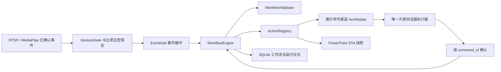

# 展厅工作流

## 结构



识别层仍只发布已经稳定确认的手势。`WorkflowEngine` 在 FastAPI 事件循环中执行，不占用 RTSP 解码线程或 MediaPipe 推理线程。每次触发最多运行一个展示工作流；主控丢失、解除、流断开导致主控解锁或展示页断开时，取消当前工作流剩余步骤。

只有主页 `/` 建立 `/ws/display` 执行通道。设置页和工作流编辑器只能收到 `/ws/events` 状态事件，不会执行展示命令。第二个展示执行客户端会以 WebSocket 1013 拒绝。展示页断开后暂停新工作流，重新打开主页即可恢复。

## 手势指针与网页拖拽

工作流编辑器提供独立的“手势拖拽”开关。开启后，只有已锁定主控人员的手部可以控制指针；伸出食指移动光标，拇指与食指捏合按下，保持捏合移动可拖动工作流节点，松开完成放置。编辑器还提供横向镜像开关，用于适配不同摄像头安装方向。

指针数据由 MediaPipe 21 点关键点计算，后端使用食指指尖坐标、掌宽归一化捏合距离、双阈值迟滞和自适应指数平滑。当前默认捏合按下/释放阈值为 0.36/0.50，食指伸展夹角门槛为 140°，指针事件最高推送频率为 45 Hz。短暂漏检会保留最后一个光标位置最多 350 ms；若漏检发生在拖拽期间，会立即释放按压状态，避免节点被一直拖住。指针模式会对主控手增加一次更宽但仍经过多人歧义检查的手腕关联尝试。指针事件经 `/ws/events` 单独发布，不进入工作流动作执行通道。启用指针模式时暂停普通手势映射，避免移动和捏合误触发播放器动作；OK 主控锁定仍保留。主控解除或视频流断开时立即释放拖拽状态。

当前网页拖拽实现范围是本项目 `/workflows` 画布中的节点；不会模拟 Windows 系统鼠标，也不承诺驱动任意第三方网页、浏览器原生文件拖放或跨域 iframe。

## JSON 协议

工作流使用 `schema_version: 1`。最小可运行定义：

```json
{
  "schema_version": 1,
  "id": "welcome-flow",
  "name": "欢迎展示",
  "description": "欢迎手势播放宣传片",
  "enabled": false,
  "trigger": {"type": "gesture_trigger", "gesture": "Open_Palm"},
  "nodes": [
    {"id": "play", "type": "action", "action": "video.play", "params": {}, "timeout_ms": 3000, "on_error": "stop", "retries": 0},
    {"id": "end", "type": "end", "params": {}}
  ],
  "edges": [{"source": "play", "target": "end"}],
  "version": 1,
  "created_at": "2026-11-11T00:00:00+00:00",
  "updated_at": "2026-11-11T00:00:00+00:00"
}
```

定义必须有唯一起点、唯一 ID、可达节点和结束节点。循环不允许。条件节点必须各有一条 `true`、`false` 边；动作错误分支 `on_error: "branch"` 必须各有一条普通边和 `when: "error"` 边。自动重试最多 2 次，并且只对注册表标记为幂等的动作开放。`web.navigate_route` 必须直接连接到结束节点，因为页面离开大屏后执行客户端会断开。

触发器：

| type | 参数 |
| --- | --- |
| `gesture_trigger` | `gesture` 为内置手势之一 |
| `gesture_sequence_trigger` | `gestures` 为 2～5 个内置手势；`sequence_window_ms` 为 1000～30000，默认 5000 |
| `controller_locked` | 无额外参数；最近 5 帧中至少 3 帧检测到同一主控人员的比耶手势后触发 |

节点：

| type | 参数 / 行为 |
| --- | --- |
| `action` | `action`、`params`、`timeout_ms` 100～60000、`on_error` (`stop` / `continue` / `branch`)、`retries` 0～2 |
| `condition` | `params.field` 只可为 gesture、confidence、handedness、target_id、action；比较方式 eq/ne/gt/gte/lt/lte/in |
| `delay` | `params.delay_ms` 0～30000 |
| `wait_event` | 等待 controller_locked、controller_lost 或指定内置 gesture；支持 `timeout_ms` |
| `end` | 空 params，无后继 |

画布位置保存在节点的可选 `position: {"x": number, "y": number}`，范围 0～5000。编辑器参数控件直接读取 `GET /api/actions` 的注册 Schema，不执行或保存用户代码。

## 动作注册表

网页动作：

| action | 参数 |
| --- | --- |
| `web.navigate_route` | `route`: home / settings / workflows；只能作为最后一个动作 |
| `web.set_scene` | `scene`: welcome / company_intro / product_intro / factory_intro / presentation_mode |
| `web.show_panel`, `web.hide_panel` | `panel`: welcome / company / product / factory / presentation |
| `web.set_text` | `field`: headline / subhead / notice；`text` 最长 160 字符，使用 textContent 写入 |
| `web.return_home` | 无 |

视频动作：`video.load` 接收 `media_id`；`video.play`、`video.pause`、`video.mute`、`video.unmute` 无参数；`video.seek` 接收 0～86400000 的 `position_ms`；`video.set_volume` 接收 0～1 的 volume；`video.set_loop` 接收 boolean `enabled`。`video.load` 会先验证素材登记和文件存在，再向浏览器发送命令。默认素材 ID `company-promo` 兼容原宣传片。

PPT 动作：`ppt.open_deck`、`ppt.start_slideshow`、`ppt.next_slide`、`ppt.previous_slide`、`ppt.goto_slide`、`ppt.end_slideshow`。每个动作都要求登记的 `deck_id`；跳转另需 `slide_number` 1～10000。所有 COM 调用在专用 STA 线程中执行。

主页收到 `{type:"command", run_id, command_id, action, params, timeout_ms}` 后执行白名单操作，并返回 `{type:"ack", run_id, command_id, success, result, error}`。服务端只接收当前单一执行客户端、且 run/command ID 均匹配的确认。前端在当前页面生命周期内对已完成 command ID 去重。超时单独记录为 `timeout`，其它错误为 `failed`，取消为 `cancelled`；错误不会静默进入下一个节点。运行记录仅存触发摘要，不保留 21 个手部关键点。

## 编辑与 API

打开 `http://127.0.0.1:8000/workflows`。左侧可拖入或点击节点；选中节点后可编辑动作参数、超时、失败策略和重试。使用“连线”后选择起点和目标；条件/错误分支先设置连线条件。拖动画布节点可改变布局，滚动条平移，缩放和自动排列只改变编辑视图/节点位置。每次保存定义变化会创建一个版本；复制会得到禁用的新工作流。模拟运行写入 dry-run 运行记录，但不会调用任何动作适配器。

| 方法 | 路径 | 用途 |
| --- | --- | --- |
| GET / POST | `/api/workflows` | 列出 / 新建 |
| GET / PUT / DELETE | `/api/workflows/{id}` | 读取 / 更新 / 删除 |
| POST | `/api/workflows/{id}/validate` | 校验已保存定义 |
| POST | `/api/workflows/validate` | 校验编辑草稿 |
| POST | `/api/workflows/{id}/dry-run` | 无副作用模拟 |
| POST | `/api/workflows/{id}/enable`、`disable`、`copy` | 启停 / 复制 |
| GET | `/api/workflows/{id}/versions` | 列出版本 |
| GET | `/api/workflow-runs`、`/api/workflow-runs/{run_id}` | 运行与步骤日志 |
| POST | `/api/workflow-runs/{run_id}/cancel` | 取消活动运行 |
| GET | `/api/actions` | 动作及参数 Schema |
| GET | `/api/media-assets`、`/api/presentations` | 白名单资源与可用状态 |
| GET | `/api/workflow-status` | 大屏客户端、主控和运行状态 |
| WebSocket | `/ws/display` | 唯一大屏命令执行与确认 |
| GET / POST | `/api/pointer/mode` | 读取 / 开关手势指针模式 |
| WebSocket | `/ws/events` | 推送手势、主控、工作流及低频指针事件 |

保存 API 仍沿用本机来源限制。开启动作触发相互重叠的工作流会返回 409；运行中的其它工作流会被拒绝，不会并行争抢展示屏。

## 媒体与 PPT 配置

在 `app/settings.py` 的 `MEDIA_ASSETS` 添加 ID、标题和 `media/` 目录下的文件名。只能登记单个文件名，不可填目录或任意路径。将文件放入本地 `media/`，重启服务后编辑器会列出素材；文件缺失时资源显示不可用，执行 `video.load` 会停止后续节点。

在同一个文件的 `PRESENTATION_DECKS` 添加受信任的 `deck_id`、标题和本机绝对路径：

```python
PRESENTATION_DECKS = {
    "company-deck": {"title": "公司介绍", "path": r"D:\Showroom\company.pptx"},
}
```

服务启动时只把管理员代码配置的 ID/路径同步到数据库，API/工作流参数不接受文件路径。Windows 原生控制需要本机安装 PowerPoint；`pywin32` 是可选依赖，不加入项目基础依赖：

```powershell
.\.venv\Scripts\python.exe -m pip install pywin32
```

若 PowerPoint 或 pywin32 不存在、PPT 文件缺失或放映命令失败，运行步骤会记录明确失败，并按节点的错误策略停止/分支。

## SQLite 与兼容性

首次打开数据库时以 `CREATE TABLE IF NOT EXISTS` 增加 `workflows`、`workflow_triggers`、`workflow_versions`、`workflow_runs`、`workflow_step_runs`、`media_assets`、`presentation_decks`。原来的 `settings`、`gesture_mappings`、置信度配置、控制会话表和事件表保持不变；没有删除旧记录的迁移。运行记录上限为 500 条，步骤记录上限为 5000 条。版本快照与工作流一起保留。

旧 `/api/mappings` 和没有同手势工作流接管时的主页播放、暂停、音量、静音逻辑仍保留。手势置信度、双手状态、OK 几何、PoseTrack、RTSP 解码/最新帧队列没有重构。

## 验证状态

自动化覆盖五个顺序动作、条件和错误分支、主控与展示连接约束、运行并发拒绝、命令确认与断开、dry-run、数据库版本、缺失视频、路径/动作白名单及 PowerPoint 不可用错误。执行：

```powershell
.\.venv\Scripts\python.exe -m unittest discover -s tests -v
```

真实展厅摄像头、实际 PowerPoint 安装、60 分钟资源稳定性和现场交互验收不属于自动化模拟结果；部署前需在目标展示机完成这些检查。
