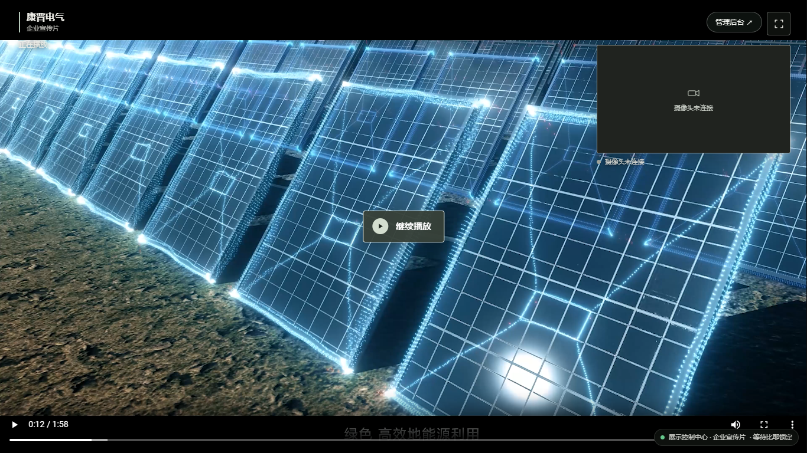
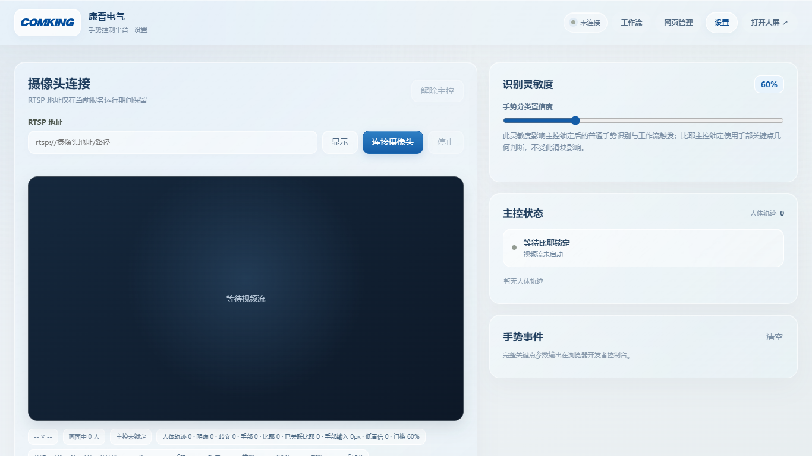
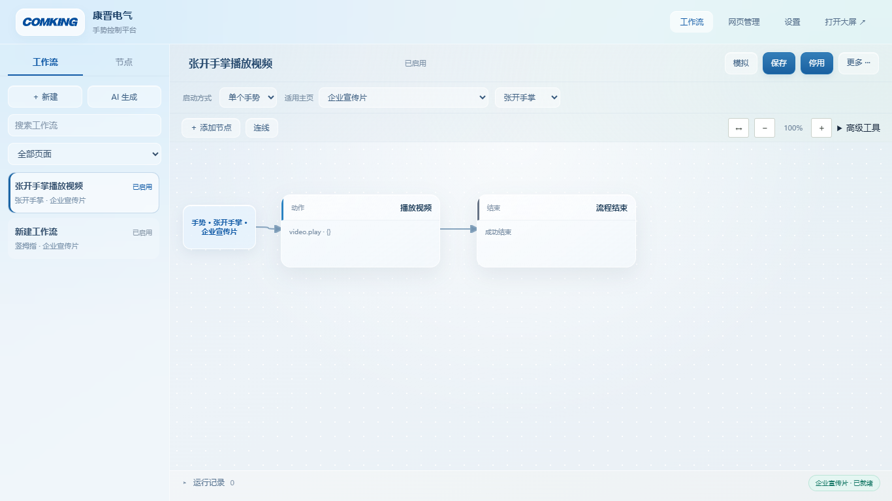
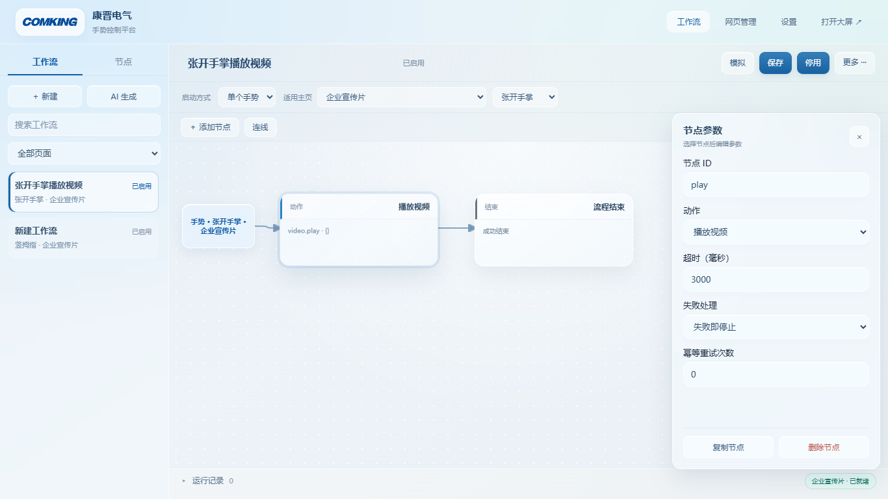

# 康晋电气手势控制平台操作手册

适用版本 1.0.0　发布日期 2026 年 11 月 23 日

本文面向展厅操作人员与工作流配置人员。日常使用顺序为：启动大屏、连接摄像头、比耶锁定主控、配置并启用工作流、回到大屏验证动作。部署和备份方法另见 Windows 部署说明。

## 1 大屏与后台分开使用

双击 `START.cmd`，保留启动窗口。浏览器打开默认企业宣传片页后，先点击“开始播放”以允许有声播放。播放器底部可以用鼠标播放、暂停、调节音量与进度；全屏通过页面右上角全屏按钮或浏览器播放器控件手动开启。

右上角“管理后台”位于全屏按钮左侧。它会打开独立后台窗口，再次点击会优先聚焦已有后台。设置、网页管理和工作流在同一个后台窗口中导航，原大屏继续保留动作执行连接。

后台“打开大屏”优先使用已有大屏。若提示已有展示窗口正在使用，应返回原大屏，关闭意外多开的展示窗口；若弹窗受阻，在浏览器中允许本网站弹出窗口。

切换本地页面或外部网页时，外层管理入口仍保留。退出时先结束演示，再在服务窗口按 Ctrl+C 停止程序。



<!-- page -->

## 2 连接摄像头与锁定主控

在后台“设置”页输入摄像头 RTSP 地址，点击“连接摄像头”，等预览画面稳定。连接后地址输入框会清空；服务重启后需重新输入。画面、人体轨迹、主控状态、识别信息及手势事件均在本页查看。

主控人面向摄像头做比耶 V 手势：食指、中指伸展，无名指和小指弯曲。比耶固定用于锁定，不作为普通播放器动作。让双肩和手部清楚进入画面，避免多人同时做锁定手势。

锁定进度使用后端实时参数，默认最近 5 帧中至少 2 帧满足条件，且唯一关联同一个人体轨迹。出现“已锁定”后，再做工作流使用的普通手势。可点击“解除主控”让另一位操作人员重新比耶锁定。

| 主控提示或状态 | 含义与操作 |
| --- | --- |
| 等待比耶锁定 | 尚无主控，先做 V 手势 |
| 已锁定 | 当前主控可执行手势 |
| 原主控手部已确认，可继续操作 | 人体短时漏检，已唯一确认原手部 |
| 身份待确认，控制暂停 | 暂停动作，等待原主控清晰进入画面 |
| 重新关联中 | 暂停并尝试找回原轨迹，超时后重新锁定 |

摄像头断线会暂停控制；恢复后必须重新比耶锁定。系统依据短时轨迹连续性管理主控，不进行人脸或生物身份认证。



<!-- page -->

## 3 工作流编辑区

进入“工作流”，左侧可切换“工作流”和“节点”页签，切换页签不会丢失当前编辑。

工作流列表统一显示单手势、手势序列和主控锁定流程。可搜索名称、描述、手势及页面，也可按适用页面筛选；每项显示名称、触发摘要及启用状态。网页管理的“配置手势”会进入对应页面的列表，新建时预填该页面。

画布上方第一行是名称、保存状态、模拟、保存、启用或停用，以及“更多”。第二行设置启动方式、适用页面和手势。**适用页面决定在哪里做手势才生效；节点中的页面切换动作决定执行后去哪里。**

“更多”中可以编辑描述、复制、删除和单独校验。节点参数默认隐藏，单击节点后从右侧抽屉编辑，可随时关闭。底部“运行记录”默认折叠，点击窄栏展开步骤和错误。



保存状态包括“未保存”“已保存未启用”“已启用”等。已经启用的流程被修改后，运行的仍是上次保存版本；保存后的变更才会影响后续触发。

<!-- page -->

## 4 新建与编排工作流

1. 在左侧“工作流”页签点击“新建”，输入明确名称，例如“宣传片播放控制”。
2. 选择启动方式。单手势使用一种稳定手势；手势序列按指定顺序输入；主控锁定流程在成功锁定时启动。序列和超时等条件按界面字段配置。
3. 选择“适用页面”。展厅宣传片控制可选“企业宣传片”；跨页面共用行为可选“全局”。页面专属流程优先于全局回退，同一作用域的重复触发配置会在启用时提示冲突。
4. 切到“节点”页签，按逻辑、网页、视频、PPT 分类查找动作。分类可折叠，搜索可按动作名称筛选；点击添加或拖入画布。
5. 单击节点，编辑动作参数、超时、失败策略等。用鼠标拖动节点调整位置，不会改变其业务含义。
6. 点击“连线”，依次选择起点与目标。连线模式下才显示条件选项；分支按节点结果选择成功、失败或条件路径，并确保存在结束节点。
7. 根据需要使用自动排列、缩放和画布滚动。点击“模拟”检查流程路径，再保存并启用。

模拟会记录模拟结果和步骤，不执行真实网页、视频或 PPT 动作，也不证明现场设备已准备就绪。



<!-- page -->

## 5 完成一次手势演示

以“张开手掌播放企业宣传片”为例。交付数据库保留打包时已保存的流程，若列表已有相同触发配置，可直接检查原流程，避免创建冲突项。

1. 工作流名称填写“张开手掌播放视频”；启动方式选单个手势，手势选“张开手掌”，适用页面选“企业宣传片”。
2. 添加“播放视频”动作节点，连接到“流程结束”。在右侧参数中确认动作与超时。本例只负责播放；暂停可另建“暂停视频”工作流。
3. 点击“模拟”，展开运行记录核对路径；点击“保存”，再“启用”。启用会执行必要保存与校验，冲突或保存失败时先按提示处理。
4. 打开大屏并确认企业宣传片页面就绪，完成首次鼠标播放；连接摄像头后比耶锁定主控，再张开手掌。
5. 同时核对视频实际播放和工作流运行记录。识别到手势、流程启动、动作执行成功是不同阶段，只有成功结果及大屏动作确认才代表执行完成。

保存失败时，草稿仍留在当前页面，不要急于刷新。切换流程、应用 AI 草稿或离开编辑页时，未保存修改会提供“保存后继续”“放弃修改”“取消”；刷新与关闭使用浏览器原生提醒。

**停用会直接作用于已保存流程。** 即使当前草稿有未完成或无效修改，也可先停用旧的启用版本。复制会创建新的未启用流程，检查其触发条件后再启用；删除会移除对应流程，应先确认选中项。

若没有已启用流程接管某一手势，保留的播放器映射可能继续处理该手势。默认张开手掌用于播放暂停，竖拇指增加音量，拇指向下降低音量；V 手势始终只用于锁定。请结合当前已保存配置核对现场行为。

<!-- page -->

## 6 网页管理与 AI 生成

网页管理可查看本地页面及已登记的外部 HTTPS 网页。点击“添加网页”填写页面 ID、名称、地址和所属页面等信息；可设为默认、启用或停用。默认页会用于后续大屏初始化，修改后应重新打开或刷新大屏验证。

点击某页面的“配置手势”，会进入该页面对应的工作流列表。该入口方便集中配置页面手势；切换页面本身仍由工作流中的页面切换节点完成。

外部网站受网络和嵌入策略影响，不能直接接受本地视频或文本控制动作。需要控制本地页面时，先切回支持页面桥的本地展示页。

AI 生成用于加快编排，使用步骤如下：

1. 点击左侧“AI 生成”，配置并测试模型服务连接。
2. 上传 PDF、DOCX、TXT 或 Markdown 文档，单个不超过 5 MB。扫描版 PDF 暂不支持 OCR。
3. 选择默认启动手势，补充业务要求，再生成草稿。
4. 阅读摘要、警告、假设和待确认问题；确认后“应用到画布”。如当前有未保存编辑，先按提示选择保存、放弃或取消。
5. 检查节点、参数、页面作用域和连线，执行模拟，最后手动保存、启用。生成与应用草稿不会自动执行流程。

AI 功能需要联网与有效账户，上传正文会发给所配置的模型服务。普通编辑、校验与模拟在无摄像头、无 AI 服务的情况下仍可使用。

<!-- page -->

## 7 高级工具与执行排查

画布“高级工具”默认折叠，包含手势指针、镜像、校准和诊断。指针模式开启时会暂停普通手势触发，页面显示醒目提示，可直接点击关闭。指针只操作本项目工作流画布，不控制 Windows 系统鼠标或任意第三方网页。

使用手势指针前先连接摄像头并锁定主控；伸食指移动光标，捏合并移动拖拽节点，松开释放。按界面引导完成四角校准；镜像和校准保存在当前浏览器内，更换电脑、浏览器或端口后需重新设置。

**手势能识别但动作没执行。** 依次检查主控是否锁定、身份是否允许控制、当前页面是否符合适用范围、流程是否保存并启用，以及指针模式是否已关闭。普通手势还有稳定帧数、置信度门槛和冷却时间要求；不要在一次动作尚未完成时连续快速触发。

**工作流启动但执行失败。** 展开底部运行记录并查看失败步骤。确认大屏连接与页面就绪、素材或 PPT 可用、动作参数正确；外部网页不支持本地控制时，先切回本地页面。模拟成功不能代替这些真实条件。

**主控提示身份待确认。** 暂停动作，让原主控及手部清晰进入画面。不要让旁人尝试接管；若恢复超时，解除后重新比耶锁定。断线重连也需要重新锁定。

**需要查看完整手势参数。** 在设置页查看手势事件，并按 F12 打开浏览器 Console。系统保留 `[gesture-control]` 完整事件对象，含手势、置信度、人员轨迹、左右手、时间和关键点等参数；看到控制台事件不等于动作执行成功。

日常交接时记录当前默认页、已启用流程及素材位置；修改配置后按部署说明备份。完成单人操作后，再验证多人、遮挡恢复及断线重连，确保现场行为与预期一致。

<!-- page -->

## 8 动作库与执行机制

左侧“节点”页签是预先实现并注册的动作库。手势识别判断“谁做了什么手势”，工作流决定执行顺序，网页 JavaScript 或 Python 适配器完成具体操作。第 8～10 章供配置人员了解和使用；第 11～12 章面向维护开发人员。

以“竖拇指后增加音量”为例，系统先确认当前主控具有操作权限，再根据手势、适用页面及启用状态匹配工作流，找到 `video.volume_up` 节点。

网页与视频动作的执行路径为：Python 工作流引擎 → WebSocket 命令通道 → 大屏外层容器 → 当前展示页 JavaScript → 返回执行结果。PPT 动作则由 Python 的 COM 适配器调用本机 PowerPoint。

### 动作节点保存的内容

下面是一个“音量增加”节点示例。动作名称、参数、超时及失败策略共同决定节点行为。

```json
{
  "type": "action",
  "action": "video.volume_up",
  "params": {},
  "timeout_ms": 3000,
  "on_error": "stop"
}
```

`action` 是动作的唯一名称；`params` 是输入参数；`timeout_ms` 是等待时间上限；`on_error` 决定失败后停止、继续或走错误分支。完整工作流还包含节点 ID、位置、启动条件及连线。

### 左栏与参数表单怎样生成

后台通过 `ActionRegistry` 注册动作名称、参数规则和执行函数，`/api/actions` 返回当前动作清单。前端读取清单后生成节点列表，并根据参数规则生成右侧数字框、文本框、勾选框或下拉框。保存和启用时，系统使用相同规则校验工作流。

每次真实网页执行带有 `run_id` 和 `command_id`。页面执行后返回确认，后台据此写入运行记录；报错、断线或超时按节点失败策略处理。模拟会生成模拟步骤，跳过真实执行函数，因此仍需核对实际页面、设备或 PPT 的结果。

<!-- page -->

## 9 现有动作的实现与范围

以下说明对应当前交付程序。网页中的元素、播放器和已登记资源决定哪些动作可在当前页面使用；节点列表列出全部注册动作，并不表示每个展示页都支持所有动作。

| 界面动作 | 具体实现 |
| --- | --- |
| 播放和暂停视频 | 调用网页 video 元素的 play 与 pause 方法 |
| 音量增加和降低 | 将 video.volume 加减 0.1，限制在 0～1 |
| 设置音量和静音 | 修改 video.volume 与 video.muted |
| 跳转进度 | 将毫秒换算成秒，设置 video.currentTime |
| 循环播放和加载视频 | 修改 video.loop；设置登记素材地址并等待加载 |
| 切换展示主页 | 大屏外层更换 iframe 地址，等待页面就绪 |
| 显示和隐藏面板 | 修改当前页面预定义面板的显示状态 |
| 设置展示文本 | 修改预定义标题、说明或通知的 textContent |
| 切换展厅场景 | 选择预设场景，切换面板、文案及页面状态 |
| PPT 操作 | 通过 PowerPoint COM 打开、放映、翻页或结束 |
| 条件和等待类节点 | 引擎判断条件、等待时间或匹配指定系统事件 |

音量控制针对当前网页播放器，范围为 0～1。增加 0.1 表示在当前值上增加 10 个百分点，例如从 0.5 变为 0.6。

文本、面板和场景动作需要展示页提前实现对应元素。当前场景主要使用预设面板及文案；维护人员可以继续加入图片、动画或业务数据。外部官网目前支持整页展示与页面切换，内部控制需要网站提供接口或配合接入。

**“打开管理页面”节点与右上角后台入口行为不同。** 当前该节点会让大屏所在窗口跳转到登记的后台路由，离开展示容器；右上角“管理后台”才会独立打开或复用后台窗口。演示过程中需要持续保留大屏连接时，使用右上角入口。

“返回首页”用于回到已设置的默认展示页；宣传片页还包含播放内容及进度复位逻辑。不同本地页面的控制能力以该页实现为准，遇到不支持的动作可在运行记录中查看错误。

<!-- page -->

## 10 使用现有动作编排新需求

新增工作流是组合已有能力，可以直接在界面完成。新增执行能力则需要开发动作函数。先检查节点库能否表达需求，能够组合时无需修改识别模型或程序代码。

### 从第 30 秒开始播放

1. 新建工作流，选择启动手势，将适用页面设为“企业宣传片”。
2. 添加“跳转进度”，参数填写 `30000` 毫秒。
3. 接入“播放视频”，最后连接“流程结束”。
4. 保存并模拟，核对步骤；启用后在真实大屏中验证进度及播放状态。

执行顺序：启动手势 → 跳转进度 30000 毫秒 → 播放视频 → 结束。

### 音量设为一半并循环播放

1. 添加“设置音量”，填写 `0.5`。
2. 添加“设置循环播放”，将开启选项设为真。
3. 接入“播放视频”和“流程结束”，再保存、模拟、启用并验证。

执行顺序：启动手势 → 设置音量 0.5 → 开启循环 → 播放视频 → 结束。

### 判断是否需要增加代码

更换已有手势的执行顺序、添加延迟、配置条件分支，以及使用已登记页面或视频，通常可在画布中完成。新页面和新素材应先按网页管理或部署说明完成登记。

设置视频倍速、实现新的图片切换效果、控制灯光或调用工厂业务接口等全新能力，需要补充动作执行代码。沿用现有启动手势时，一般无须修改 MediaPipe 识别部分。

AI 生成读取同一份动作注册清单，用于组合已经实现的能力。全新的设备能力仍需开发适配器，再提供给工作流和 AI 生成使用。

<!-- page -->

## 11 新增视频倍速动作示例

本章为开发示例。当前 1.0.0 程序未内置 `video.set_playback_rate`；需要完成下面三处修改并验证，才会实际获得倍速功能。文件路径相对于工程或运行包的解压根目录。

### 注册动作及参数

在 `app/video_actions.py` 的 `registrations` 列表中增加：

```python
(
    "video.set_playback_rate",
    {"rate": {
        "type": "number", "title": "播放速度",
        "minimum": 0.5, "maximum": 2,
    }},
    ["rate"],
    True,
),
```

参数 rate 是 0.5～2 的数字。末尾的 True 表示重复设置同一个值结果不变，可按幂等动作处理。音量增加等累加动作应保持非幂等，避免重试重复累加。

### 实现浏览器执行分支

在 `web/player.js` 的 `executeDisplayAction()` 中增加：

```javascript
case "video.set_playback_rate": {
  const rate = params.rate;
  if (typeof rate !== "number" || !Number.isFinite(rate)
      || rate < 0.5 || rate > 2) {
    throw new Error("播放速度必须在 0.5～2 之间");
  }
  video.playbackRate = rate;
  return { playback_rate: video.playbackRate };
}
```

### 增加界面名称

在 `web/workflows.js` 的 `ACTION_LABELS` 对象中增加：

```javascript
"video.set_playback_rate": "设置播放速度",
```

重启服务并刷新后台后，新动作会进入“视频”分类，右侧根据注册规则自动生成播放速度输入框。在企业宣传片页面实际测试倍速及执行结果，再重新制作交付包。

<!-- page -->

## 12 新增设备动作与发布验证

开灯、控制继电器或调用业务接口，可采用“工作流动作 → Python 适配器 → 设备 HTTP、MQTT 或 SDK 接口”的结构。动作通常使用受控的设备 ID、通道号及目标状态作为参数，由适配器负责连接、调用、超时及结果判断。

| 扩展位置 | 维护内容 |
| --- | --- |
| app/device_actions.py | 新建设备适配器及动作注册函数 |
| app/main.py | 在 create_app 中初始化适配器并调用注册函数 |
| web/workflows.js | 添加动作中文名称，必要时添加节点分类 |
| tests | 验证参数、调用结果、超时及失败处理 |

若新动作名采用 `device.light_on` 这样的新前缀，需要在 `renderActionLibrary()` 的分类数组中补充：

```javascript
{ label: "设备", prefix: "device.", open: true },
```

当前分类依据 web.、video. 和 ppt. 前缀生成；新前缀只做后台注册时，左侧节点分类不会自动出现。已有分类内增加动作则可复用原分类。普通参数表单依据动作 schema 生成。

网页类新动作还需在目标页面的 JavaScript 中实现执行分支；设备或 PPT 类动作由 Python 适配器执行。命令应返回能够判断是否完成的结果；设备仅接收请求但尚未完成时，应按实际接口约定处理确认。

修改后按以下顺序验证并发布：

1. 在独立测试副本中开发，保留原运行包及数据库备份。
2. 检查动作参数、允许范围、资源 ID 和重复执行语义；对接口调用设置超时。
3. 重启服务并刷新后台，确认节点分类、中文名称及参数表单正常显示。
4. 完成保存校验、模拟、错误参数和超时处理测试。模拟不会调用真实设备。
5. 在支持该动作的页面或设备上实际执行，核对页面、设备状态及运行记录。
6. 运行相关回归检查，重新打包并更新文档与校验清单，再交付新版本。

新增动作按现有注册表与参数格式接入时，通常无需更改数据库结构。修改解压目录中的源码不会自动更新已经发出的 ZIP；发布时应明确区分旧包与新包。
